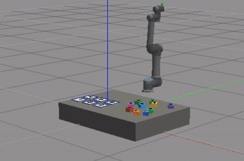
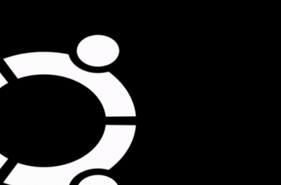
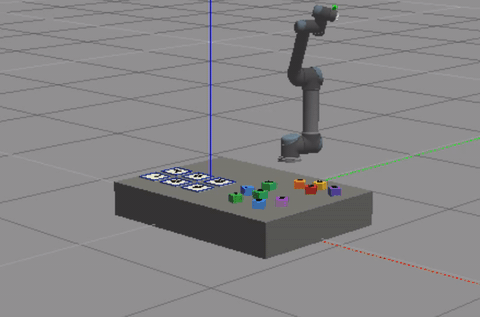

# 抓取模块验收文档

## 一、目标

实现 UR5 在 Gazebo 仿真环境中的端到端 pick-and-place：从视觉识别到的方块坐标出发，飞到目标方块上方、垂直下压、吸附、抬升、搬运到对应数字格子、放下，再回到初始姿态。

## 二、关键改动

| 改动 | 说明 |
|---|---|
| 引入 `gazebo_ros_link_attacher`（commit `5aa2391`） | 物理层 fixed joint 焊接，替代不稳定的 vacuum plugin AddForce |
| 焊接目标 link：`wrist_3_link` | URDF→SDF 后 `vacuum_gripper`/`ee_link` 被 fixed joint reduction 合并消失，只能用 `wrist_3_link` |
| `block_mass: 0.05 → 0.02`（20g） | 兼顾物理真实性和吸附稳定性 |
| `place_pose.z` 增加 `+0.045` 补偿 | 包含 EE 到方块中心 25mm + grid 板厚 4mm + 悬空安全余量 |
| `place retreat` 改为 `move_to_pose` | 替代 cartesian path（容错性更高，避免 `fraction=0.0` 失败） |
| 新增 `returning_home` 阶段 | 抓取完毕回到 SRDF 命名姿态 `up`，方便连续多次抓取 |
| Dockerfile 内置 link_attacher 源码 | 接力者 `docker build` 后直接可用 |

## 三、验收流程

启动 4 个终端，每个终端先 `docker exec -it ur5_grasp_kinetic bash`，然后：

```bash
# 终端 1：仿真（保持运行；等到 "Assignment scene ready:" 才能进下一步）
roslaunch ur5_notebook assignment_env.launch seed:=42 gui:=true

# 终端 2：检测 + 定位
roslaunch ur5_notebook detection_localization.launch

# 终端 3：抓取执行器
roslaunch ur5_notebook grasp_executor.launch

# 终端 4：发命令
rostopic pub -1 /grasp/target_class_id std_msgs/Int32 "data: -1"
rostopic echo /grasp/status
```

## 四、验收标准

- [x] `[link_attacher] attached digit_block_X to vacuum_gripper` 日志出现
- [x] 视觉效果：方块完全跟随机械臂（不旋转、不脱离、不瞬移）
- [x] 方块准确放置到对应数字 grid 板上（不陷板、不悬空）
- [x] `[link_attacher] detached digit_block_X (ok=True)` 释放成功
- [x] 机械臂自动回到 `up` 姿态
- [x] `/grasp/status` 完整状态机 `idle → ... → returning_home → done`

## 五、Demo

| Demo 1 | Demo 2 | Demo 3 |
|---|---|---|
|  |  |  |
